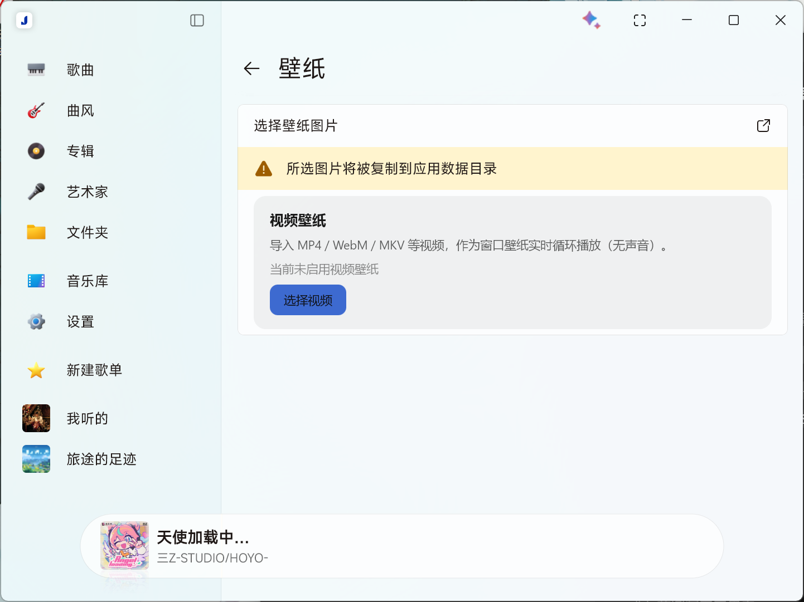

# 视频壁纸

把视频当壁纸用。铺满 Salt Player 的窗口，静音循环播放。



支持 **Salt Player for Windows 1.19.0**，Windows 64 位。

---

## 能做什么

- **视频当壁纸**：选一段 MP4 / MKV / WebM，直接铺满窗口，不拉伸不变形
- **两种用法**：
  - 选一个视频 —— 一直循环这一段
  - 选一个文件夹 —— 每次你**把窗口最小化再打开**，换里面随机的一个
- **不吵**：播放过程中不会自动切视频，也不会出声
- **随时能关**：面板里可以暂停、换一个、移除

---

## 安装

1. 到 [Releases](https://github.com/azkbzxf/spw-video-wallpaper/releases) 下载 `plugin-com.videowallpaper.spw-1.0.0.spmod`
2. 打开 Salt Player → 设置 → **插件 / Workshop** → 从文件安装
3. 在插件列表里给「视频壁纸」**允许 `class-transform` 权限**
   （不允许的话插件能装上，但界面上不会出现任何东西）
4. 重启 Salt Player

---

## 使用

打开 **设置 → 外观 → 壁纸**，面板最下面会多出一块「视频壁纸」。

### 用一个视频

点 **选择视频**，挑一个文件。立刻生效，之后一直循环这一段。

### 用一整个文件夹

点 **选择文件夹**，选一个装着视频的文件夹（会连子文件夹一起找，最多 4 层）。

插件会随机挑一个开始播。之后：

- **不会自动换片**，你正在看的这段会一直循环；
- 想换的时候，把窗口**最小化，再打开**，就会随机换成另一个；
- 不想等最小化，也可以直接点面板上的 **换一个**。

卡片上会显示当前是第几个，比如 `播放中：xxx.mp4 · 3/12`。

> 插件只是记住文件路径，**不会复制视频**。
> 如果你移动或删除了原文件，壁纸会失效，重新选一次就好。

---

## 想调一下

插件目录里有个 `video-wallpaper.properties`，用记事本打开改，改完重启 Salt Player：

```properties
dim=0.18      # 画面暗化的程度，0 = 不暗，0.8 = 很暗
speed=1.0     # 播放速度，1.0 = 原速
paused=true   # 想让壁纸停在第一帧就改成 true
```

文件位置（Microsoft Store 版）：

```
%APPDATA%\Salt Player for Windows\workshop\plugins\plugin-com.videowallpaper.spw-1.0.0\
```

---

## 常见问题

**壁纸页里没有「视频壁纸」这一块？**
八成是权限没给。去 设置 → 插件 / Workshop，给「视频壁纸」勾上 `class-transform`，然后重启。

**选了视频，窗口是黑的？**
先确认文件能用别的播放器打开。少数特殊编码解不了，换一个 MP4 试试。
详细原因会写在插件目录的 `video-wallpaper.log` 里。

**最小化了也打开过，但没换片？**
要真的**最小化**（点窗口右上角的最小化按钮），只是切到别的窗口再切回来不算。
另外文件夹里至少要有两个视频。

**想换回图片壁纸？**
面板里点 **移除**，或者用上面的「选择壁纸图片」重新选一张图。

**和「壁纸材质」的模糊效果一起用？**
模糊只作用在图片壁纸上，视频不会变模糊（暗化效果仍然有用）。

---

## 兼容性

只针对 **Salt Player for Windows 1.19.0** 做过适配。宿主换版本后插件可能失效，
但不会影响播放器本身 —— 顶多是壁纸区域什么都不显示。

---

## 关于

MIT License。实现细节、构建方法、适配新版本宿主需要改哪里，都写在 [docs/TECH.md](docs/TECH.md)。
